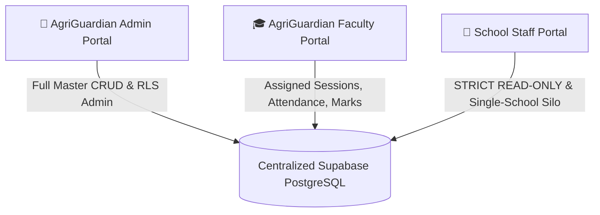

# AGRIGUARDIAN LMS
### Multi-School AI + IoT Education Management and Monitoring Platform

[](https://nextjs.org/)
[](https://www.typescriptlang.org/)
[](https://tailwindcss.com/)
[](https://supabase.com/)
[](#)

---

## 📖 Overview

**AgriGuardian LMS** is an enterprise-grade, modern, and responsive web application engineered specifically for **AgriGuardian** to manage and monitor its AI + IoT educational programs across multiple partner schools.

The platform is architected to effortlessly scale to **100+ schools**, providing unified curriculum governance, verifiable daily attendance telemetry, quad-pod student innovation team tracking, and standardized 100-mark monthly assessments.

---

## 🏰 Three Independent Portals

All three portals connect to the same centralized PostgreSQL database with strict **Row Level Security (RLS)**:



### 1. 👑 AgriGuardian Admin Portal (`/admin/*`)
The central command center for AgriGuardian leadership:
- **Dashboard**: Real-time aggregated statistics across all partner schools, attendance trends, course completion metrics, and session schedules.
- **School Management**: Onboard new campuses, modify details, activate/deactivate schools, set capacity limits, and assign institutional staff.
- **Faculty Management**: Create faculty accounts, assign instructors to schools/classes, monitor teaching loads, and manage substitute authorization.
- **Staff Management**: Create school staff accounts tied strictly to their respective schools to enforce institutional data isolation.
- **Student Management**: Individual enrollment, bulk CSV importing with templates, class/section assignments, and transfers.
- **Class & Section Management**: Govern Classes 6, 7, 8, and 9 with sections (A, B, C...) and standard 5-chapter AI+IoT curricula.
- **Timetable Management**: Session scheduling, assigning faculty, dates, times, and lab rooms.
- **Reports & Analytics**: School attendance matrices, faculty activity logs, monthly performance summaries, and team dossiers (CSV / Print).
- **Audit Logs**: Immutable audit log of every creation, modification, attendance check, and mark submission.

### 2. 🎓 AgriGuardian Faculty Portal (`/faculty/*`)
A common, unified workspace for all AgriGuardian faculty members:
- **Module 1: Daily Class Selection**: Select school, class (6, 7, 8, 9), section, date, chapter, and timing. Auto-loads enrolled students. **Anti-impersonation guarantee**: logged-in faculty identity is automatically locked.
- **Module 2: Student Attendance**: Professional attendance interface with Present, Absent, Late, Excused statuses, 1-click **"Mark All Present"**, duplicate submission checks, and live attendance percentages.
- **Module 3: Student Team Management**: Group students into collaborative innovation pods of **exactly 4 members wherever possible**, assign designated team leaders, and handle remainder teams. Enforces that no student can belong to multiple active teams.
- **Module 4: Team-Wise Progress Tracking**: Independent dashboards for each team tracking the 5 chapters, hands-on practical labs, project milestones, demonstration photographs/videos, and qualitative faculty remarks.
- **Module 5: Monthly Internal Assessment**: 100-mark standardized rubric:
  - Theoretical Knowledge: 20 marks
  - Practical Skills: 30 marks
  - Project Performance: 30 marks
  - Creativity and Innovation: 10 marks
  - Participation: 10 marks
  - *Auto-calculates total marks, percentage, grade (A+, A, B, C, D, F), and performance categories.*

### 3. 🏫 School Staff Portal (`/staff/*`)
Dedicated institutional monitoring for school leadership (Principals, Vice Principals, STEM Coordinators):
- **Strict Read-Only Access**: Zero create, edit, or delete permissions at the database level.
- **Single-School Data Isolation**: Staff can only view records belonging to their assigned campus.
- **Module 1: Class-Wise Student Details**: Class 6-9 roster with attendance rates, assigned teams, and grades.
- **Module 2: Attendance Monitoring**: Daily, weekly, monthly views, student-wise filters, and export to CSV / Printable PDF.
- **Module 3: Team-Wise Progress Monitoring**: Inspect 4-member teams, prototypes, photos, demonstration videos, and faculty remarks.
- **Module 4: Monthly Assessment Monitoring**: Rubric scores breakdown, total marks, letter grades, and class averages.
- **Module 5: Reports**: 1-click downloads of student attendance, monthly assessment cards, and team project dossiers.

---

## 🛠️ Technology Stack

- **Frontend**: Next.js 16 (App Router) with TypeScript
- **Styling**: Tailwind CSS with custom AgriGuardian theme (`#14532D`, `#16A34A`, `#F8FAFC`, `#1E293B`, `#E2E8F0`)
- **Database**: Supabase PostgreSQL (23 normalized tables with foreign keys and RLS)
- **Authentication**: Supabase Auth + Resilient Local Session Provider
- **Storage**: Supabase Storage bucket (`agriguardian-media`)
- **Visualizations**: Recharts
- **Icons**: Lucide React
- **Validation**: Zod & custom business constraint checkers
- **Deployment**: Vercel ready

---

## 🗄️ Database Architecture (23 Tables)

The complete schema is available at `supabase/schema.sql` and `supabase/seed.sql`:

1. `schools` - Partner schools, campuses, and capacity
2. `profiles` - Central user accounts (admin, faculty, staff)
3. `school_staff` - School coordinators tied to school UUIDs
4. `faculty` - AgriGuardian specialist instructors
5. `classes` - Classes 6, 7, 8, 9
6. `sections` - Sections (A, B, C...) per school/class
7. `students` - Student directory and parent contacts
8. `enrollments` - Academic year enrollment status
9. `teams` - 4-member student innovation teams
10. `team_members` - Enforces 1 active team per student
11. `faculty_assignments` - Faculty-school-class allocations
12. `sessions` - Daily academic session slots
13. `attendance` - Per-student attendance status & faculty attribution
14. `curriculum` - Class syllabi per academic year
15. `chapters` - 5 chapters per class (2 AI, 2 IoT, 1 Capstone)
16. `practical_activities` - Hands-on hardware experiments
17. `team_progress` - Completion tracking for each chapter
18. `projects` - Team IoT prototypes, stages, and milestones
19. `project_media` - Photos and demonstration videos
20. `assessments` - Monthly assessment headers (100 marks)
21. `assessment_marks` - Theory, Practical, Project, Creativity, Participation
22. `faculty_remarks` - Technical, innovation, and improvement comments
23. `audit_logs` - Immutable system action logs

---

## 🚀 Getting Started

### 1. Prerequisites
- Node.js v18+ or v20+
- npm v9+

### 2. Installation
```bash
cd agriguardian-lms
npm install
```

### 3. Environment Setup
Copy the environment template:
```bash
cp .env.example .env.local
```

Fill in your Supabase project credentials in `.env.local`:
```env
NEXT_PUBLIC_SUPABASE_URL=https://your-project.supabase.co
NEXT_PUBLIC_SUPABASE_ANON_KEY=your-anon-key-here
SUPABASE_SERVICE_ROLE_KEY=your-service-role-key-here
NEXT_PUBLIC_SUPABASE_STORAGE_BUCKET=agriguardian-media
```

> **Note on Resilient Demo Mode:** If Supabase credentials are not yet configured, AgriGuardian LMS runs out-of-the-box with full reactive local persistence and comprehensive seed data, allowing 100% interactive testing without setup blockers.

### 4. Database Setup (Supabase)
In your Supabase project SQL Editor:
1. Execute `supabase/schema.sql` to generate all 23 tables and RLS security policies.
2. Execute `supabase/seed.sql` to populate multi-school demo data, classes 6-9, AI+IoT curriculum, students, and teams.

### 5. Running the Application
```bash
npm run dev
```
Open [http://localhost:3000](http://localhost:3000) in your browser.

---

## ⚡ Instant Demo Credentials

Use the fast 1-click role switcher buttons on the login page or top navigation bar:

| Role | Name | Email | Permissions |
| :--- | :--- | :--- | :--- |
| **👑 Admin** | Vikramaditya Roy | `admin@agriguardian.io` | Master control over all schools & users |
| **🎓 Faculty** | Dr. Arun Kumar | `dr.arun@agriguardian.io` | Attendance marking, teams, progress & marks |
| **🏫 School Staff** | Rajiv Menon | `staff.greenwood@school.edu` | **Strict Read-Only** (Greenwood STEM Academy) |
| **🏫 School Staff** | Sunita Rao | `staff.xavier@school.edu` | **Strict Read-Only** (St. Xavier's Model Tech) |

---

## 🚢 Deployment (Vercel)

1. Push this repository to GitHub or GitLab.
2. Import the project into [Vercel](https://vercel.com).
3. Set the environment variables (`NEXT_PUBLIC_SUPABASE_URL`, `NEXT_PUBLIC_SUPABASE_ANON_KEY`, `SUPABASE_SERVICE_ROLE_KEY`).
4. Click **Deploy**.
